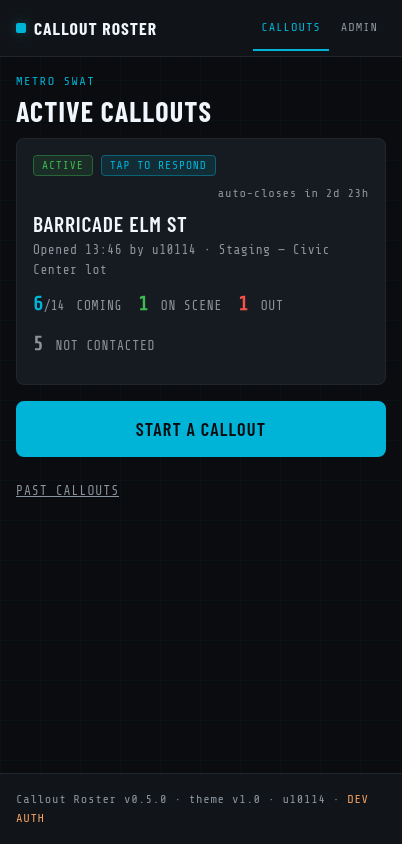
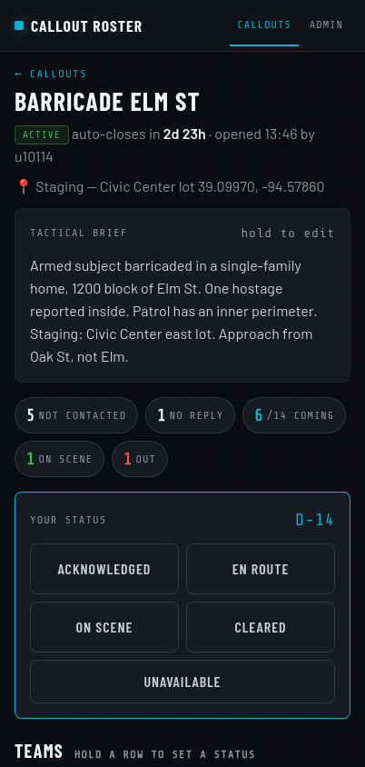
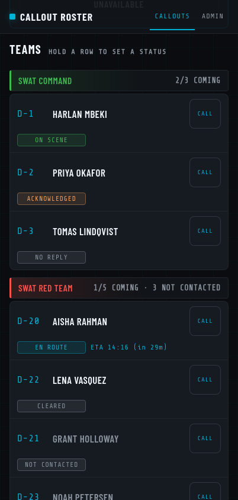
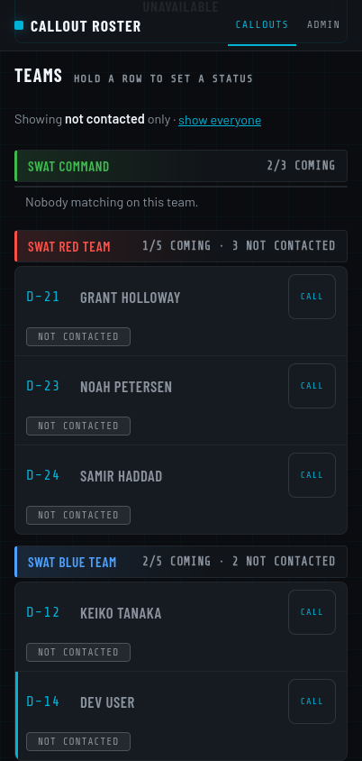
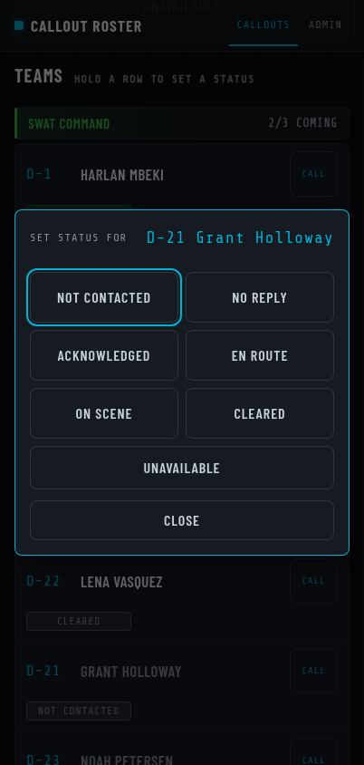
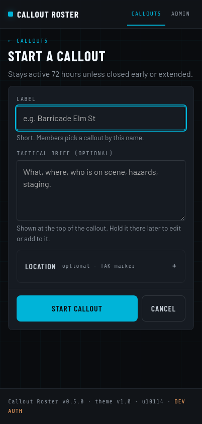
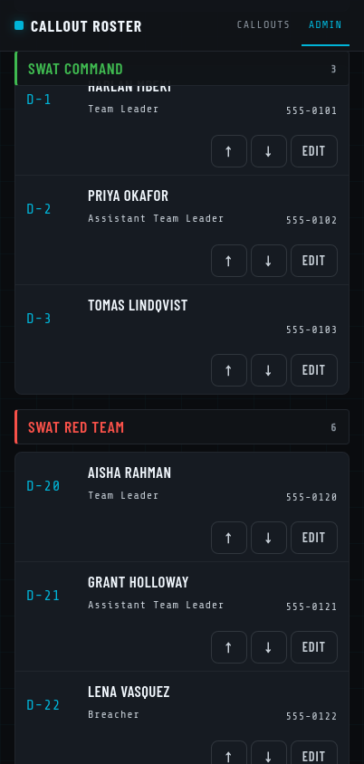
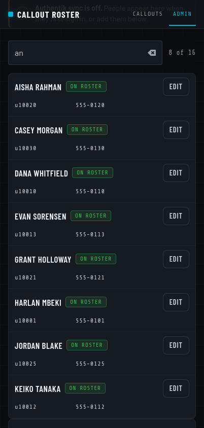
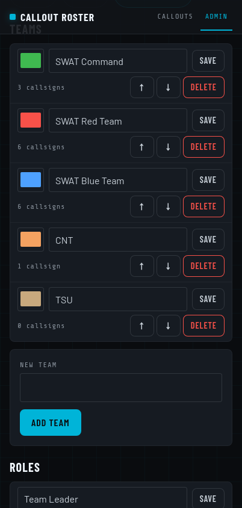
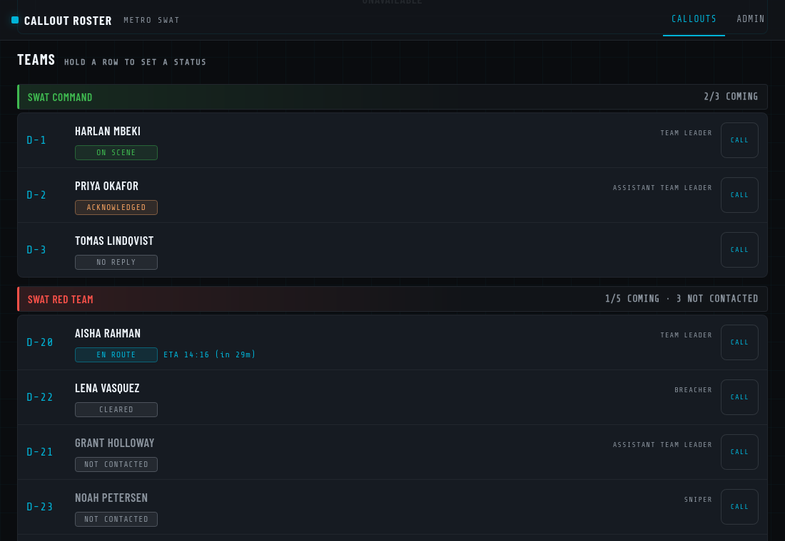

# Callout Roster

A small, phone-first web app for a tactical team's callout: who has been
reached, who is coming, who is on scene. One tap to answer; one screen for the
lead to see the whole roster. Flask + SQLite in one Docker image, no JavaScript
framework, no outside calls at runtime. It sits behind a reverse proxy that
does the login (Authentik forward auth or anything that sets a username
header) and can be pinned to a phone's home screen like an app.

All screenshots below use the built-in seed data: made-up names, 555 numbers,
a fictional unit.

## What it does

<table>
<tr>
<td width="33%"></td>
<td width="33%"></td>
<td width="33%"></td>
</tr>
<tr>
<td><b>Home.</b> The running callout, its counts, and the button to start one. Nothing else.</td>
<td><b>A callout.</b> Tactical brief, the five numbers a lead needs (not contacted, no reply, coming, on scene, out), and the member's own five buttons.</td>
<td><b>The teams.</b> Every member on one line in the same shape: callsign, name, Call; status, ETA. Headers stick while you scroll.</td>
</tr>
<tr>
<td></td>
<td></td>
<td></td>
</tr>
<tr>
<td><b>Who have we not reached?</b> Tap a counter to see only those people, with their Call buttons. The filter survives refreshes and can be shared as a link.</td>
<td><b>Marking others.</b> A lead holds a row to set that member's status after phoning them: No reply, Acknowledged, En route (then an ETA), and so on.</td>
<td><b>Starting one.</b> A label is enough; the brief and location can be added now or later from the callout page. The Start button stays in reach.</td>
</tr>
</table>

- **One tap to respond.** A member opens the callout and taps *Acknowledged*,
  *En route* (then picks an ETA), *On scene*, *Cleared* or *Unavailable*.
  Everyone starts as *Not contacted* until somebody changes it.
- **Everything in the same place.** Every roster line has the same shape, the
  Call button never moves (it is greyed out when there is no number), and the
  pop-up sheets always open in the middle of the screen. People use this under
  stress and by muscle memory.
- **Live without reloading.** Open pages poll a tiny version number and swap
  in only what changed; nothing scrolls or flashes, and what did change glows
  for a moment.
- **Team building** under Admin: a searchable people list (synced from
  Authentik or added by hand), callsigns and roles, teams with colours. An
  optional admin password locks those pages.
- **A record.** Every callout exports as a PDF with the timeline and each
  member's response, and a hook fires on every event for TAK Server
  integration.
- **Works without JavaScript.** Every action is a plain form; the script only
  adds conveniences.

<details>
<summary>More screenshots: admin pages and the desktop layout</summary>
<table>
<tr>
<td width="33%"></td>
<td width="33%"></td>
<td width="33%"></td>
</tr>
</table>

</details>

There is one unit (from the `DEFAULT_UNIT_*` variables; the seed calls it
Metro SWAT) with teams such as SWAT Command, SWAT Red Team, SWAT Blue Team and
CNT. Tables carry a `unit_id`, so more units can be added later without a
redesign, but there is no unit management in the UI today.

## Install (production)

```bash
cp .env.example .env     # optional; every value has a default
docker compose up -d
```

That is the whole install. The container listens on plain HTTP on `PORT`
(default 8080), runs as a non-root user, logs to stdout, restarts unless
stopped, and keeps its one SQLite file in the `roster-data` volume at `/data`.

Compose publishes the port on **127.0.0.1 only** (`HOST_PORT`, default 8080).
Docker-published ports bypass host firewalls such as UFW, and the app trusts
the identity headers it receives, so it must only be reachable through the
proxy. A proxy on the host (Caddy, say) points at
`127.0.0.1:<HOST_PORT>`; a proxy in a container can instead share a Docker
network with the app (see the comment in `docker-compose.yml`).

`GET /healthz` returns 200 without authentication, but behind forward auth
the public URL answers it with a redirect to the login page. Monitor it on
the host at `http://127.0.0.1:<HOST_PORT>/healthz`.

The proxy must add these headers to every request:

| Header | Example | Meaning |
| --- | --- | --- |
| `X-authentik-username` | `u10114` | Who the user is. Missing → 401. |
| `X-authentik-groups` | `tak_Metro SWAT\|tak_Other` | Pipe-separated group names. |
| `X-authentik-name` | `Jane Doe` | Optional. Fills the person's name while it is blank or just the username. |
| `X-authentik-email` | `jd@example.org` | Optional. Fills the person's email while it is blank. |

**Access.** A unit belongs to one Authentik group (`DEFAULT_UNIT_MEMBER_GROUP`).
Everyone in it may see callouts, respond, mark other people's status, edit
the brief, export the PDF and (with `CALLOUT_OPEN_ROLE=member`, the default)
start, extend and close callouts. Group names must match Authentik exactly,
prefix included: TAK Portal creates groups as `tak_<name>`, so Metro SWAT's
group is `tak_Metro SWAT`.

**Admin password.** Set `ADMIN_PASSWORD` to lock the team-building pages
(Roster, People, Teams & roles). Members then enter it once per device; the
unlock lasts `ADMIN_UNLOCK_HOURS` (12) in a signed cookie tied to their
username, and the **Lock** button ends it early. Five wrong tries in ten
minutes lock that user out for ten minutes. Set `SECRET_KEY` as well, or
every restart locks admin again. With `ADMIN_PASSWORD` blank the pages are
open to every member.

**The unit** is created on first start from the `DEFAULT_UNIT_*` variables,
and those are re-applied on every start: change one in `.env`, restart, and
the unit is updated in place (the log says what changed). No database wipe.

## Upgrades and the database

The schema is versioned and migrates itself in place on start. Before any
migration the existing file is copied to
`/data/callout_roster.sqlite3.bak-v<old version>`. Migrations alter tables;
they never drop and recreate them. Back up the volume before an upgrade
anyway:

```bash
docker compose cp callout-roster:/data/callout_roster.sqlite3 ./roster-backup.sqlite3
```

When the server deploys from a git bundle (as the reference deployment does), an upgrade is:

```bash
git pull /path/to/callout-roster.bundle main
docker compose up -d --build
```

## People come from Authentik

The app keeps a `people` table keyed by Authentik username. It is filled three
ways, in order of authority:

1. **Authentik sync.** With `AUTHENTIK_URL` and `AUTHENTIK_TOKEN` set, the app
   calls `GET /api/v3/core/users/?groups_by_name=<group>` for each unit's
   member group, on start and every `AUTHENTIK_SYNC_MINUTES`, and from the
   "Sync now" button on the People page. It stores username, name, email and
   the custom attribute named by `AUTHENTIK_PHONE_ATTRIBUTE` (default `phone`).
   People who drop out of every synced group are marked as having left. A
   group Authentik does not know (it answers HTTP 400) is skipped with a
   warning on the People page; the rest still sync, and nobody is marked as
   left after such a partial sync.
2. **Signing in.** Every authenticated request upserts the person from the
   headers, so the app knows everyone who has ever opened it even with no API
   token. The name and email headers fill those fields while they are empty;
   phone stays blank until a sync or an admin fills it in.
3. **By hand.** The People page has an add form for stragglers.

Work phones can be edited on the People page for anyone; a number typed
there overrides the synced one and survives later syncs (clear it to fall
back). Callsigns, teams and roles are only ever set in the app.

Leads build teams from that list: pick a person, a team, a callsign (e.g. D-14) and a role. Callsigns are entered in the app, never read from Authentik, because the callsign used on a callout can differ from the one stored there.
Roles are a per-unit pick-list (defaults: Team Leader, Assistant Team Leader,
Entry, Breacher, Sniper, Medic) that leads can change at any time. Nobody types
a username, so the username on a roster row always matches the header, and the
response buttons appear on the right row automatically.

The token needs read access to users and groups only. In Authentik: create a
service account user, give it a non-expiring token, and give it a role with
only `Can view User` and `Can view Group`. Keep the token in `.env`, never in
the repo.

To serve under a sub-path, set `BASE_PATH=/roster`. Every link in the HTML is
relative, so it works whether the proxy strips the prefix or forwards it.
`X-Forwarded-Proto`, `-Host` and `-Prefix` are honoured.

## Local development

```bash
python3 -m venv .venv && . .venv/bin/activate
pip install -r requirements-dev.txt
cp .env.example .env            # then set AUTH_MODE=dev
export $(grep -v '^#' .env | xargs)
python -m scripts.seed_dev      # fake roster for the default unit
python -m app                   # http://localhost:8080
pytest
```

`AUTH_MODE=dev` pretends the proxy sent `DEV_USERNAME` and `DEV_GROUPS`. In that
mode the app binds to 127.0.0.1 and refuses any request whose `Host` is not
localhost. The seed script gives position D-14 the dev username so there is a
row to respond on. All seed numbers are fictional 555-01xx numbers; never
commit a real number.

Members use iPhones, and iOS Safari (WebKit) lays out grid and flex edge cases
differently from Chrome. After any layout change, render the page in WebKit
too, at a phone width, before calling it done:

```bash
python3 scripts/webkit_check.py http://localhost:8080/u/swat/callouts/1 402 /tmp/callout.png
```

It needs the system `python3` with WebKitGTK (`gir1.2-webkit-6.0`), prints any
roster row whose text spills past its box, and saves a screenshot. The
`0.3.0` "NO REPL" clipping on iPhones was invisible in Chrome and shows up
here.

Fonts are bundled (`app/static/fonts/`, SIL Open Font License) so the app makes
no outside calls at runtime. Re-run `python scripts/fetch_fonts.py` only when
upgrading the theme.

## Configuration

All settings are environment variables with defaults; see `.env.example`.
The ones that matter most:

| Variable | Default | Purpose |
| --- | --- | --- |
| `PORT` | `8080` | Listening port inside the container |
| `BASE_PATH` | *(blank)* | Sub-path the app is served under |
| `DATA_DIR` | `./data` (`/data` in Docker) | Where the SQLite file lives |
| `TZ` | `UTC` | Display time zone |
| `HOST_PORT` | `8080` | Port published on 127.0.0.1 for a proxy on the host |
| `AUTH_MODE` | `proxy` | `proxy` or `dev` |
| `AUTH_NAME_HEADER` / `AUTH_EMAIL_HEADER` | `X-authentik-name` / `-email` | Fill name/email on sign-in; blank to ignore |
| `ADMIN_PASSWORD` | *(blank)* | Locks the admin pages; plain text or a Werkzeug hash |
| `ADMIN_UNLOCK_HOURS` | `12` | How long one unlock lasts |
| `SECRET_KEY` | *(random per start)* | Signs form tokens and the unlock cookie; set it |
| `DEFAULT_UNIT_MEMBER_GROUP` | `Metro SWAT` | The unit's Authentik group, exactly (e.g. `tak_Metro SWAT`) |
| `AUTHENTIK_URL` | *(blank)* | Authentik base URL as seen from the container |
| `AUTHENTIK_TOKEN` | *(blank)* | Read-only API token |
| `AUTHENTIK_SYNC_MINUTES` | `10` | Sync interval; 0 disables the timer |
| `AUTHENTIK_PHONE_ATTRIBUTE` | `phone` | Custom user attribute holding the work phone |
| `CALLOUT_OPEN_ROLE` | `member` | Who may open, close early, extend and brief callouts: `member`, or `admin` (= unlocked with the admin password) |
| `CALLOUT_DURATION_HOURS` | `72` | How long a callout stays open |
| `CALLOUT_EXTEND_HOURS` | `24` | Size of one extension step (no cap) |
| `CALLOUT_MAX_OPEN` | `2` | Open callouts per unit; a third is refused |
| `EXPIRY_CHECK_SECONDS` | `60` | Background expiry interval; 0 disables the thread |

## Pages

| Path | Who | What |
| --- | --- | --- |
| `/` | anyone | Redirects to the unit's callouts; a note if you are not in the member group |
| `/u/<slug>/` | members | Active callouts and the Start button |
| `/u/<slug>/callouts/<id>` | members | One callout: your status buttons, then every team with each member's status |
| `/u/<slug>/callouts/new` | per `CALLOUT_OPEN_ROLE` | Start a callout: label, optional location |
| `/u/<slug>/callouts` | members | Past callouts |
| `/u/<slug>/admin/…` | members, after `ADMIN_PASSWORD` if set | Roster (pick-list), People (sync), Teams & roles |
| `/u/<slug>/admin/unlock` | members | Enter the admin password |
| `/u/<slug>/callouts/<id>/record.pdf` | members | The official PDF record of a callout |
| `/u/<slug>/version`, `/u/<slug>/callouts/<id>/version` | members | `{"v": <last event id>}`, polled by the live pages |
| `/healthz` | nobody required (loopback when behind forward auth) | `{"status":"ok"}` |

### On a phone

The app ships a web-app manifest and home-screen icons
(`static/manifest.webmanifest`, `static/icon-*.png`). Members should add it to
their home screen once — Safari: Share → *Add to Home Screen*; Chrome: menu →
*Add to Home screen* / *Install app* — and from then on it opens full-screen
from its own icon, like an app, without the browser bars. There is no service
worker on purpose: the roster is live data and must never be served from a
stale cache. The icons are rendered from `static/icon.svg` with ImageMagick
(`convert -background none -density 384 icon.svg -resize 192x192 icon-192.png`).

## Callouts

- Up to `CALLOUT_MAX_OPEN` (2) open per unit, each with a short label, who
  opened it and when, an expiry and an optional location.
- Everyone starts as **Not contacted**: that is what a line shows until
  somebody changes it. A member taps **Acknowledged**, **En route**, **On
  scene**, **Cleared** or **Unavailable** on their own card; En route then
  asks for an ETA (90/60/45/30/15/5 min), shown as a clock time. A lead who
  holds someone's row gets those plus **No reply** (phoned, no answer) and
  **Not contacted** (to reset a mistake). A later tap replaces the status;
  first and last tap times are kept.
- Counts per team are shown on each callout card. Closed callouts stay in
  the history list.
- **Two callouts at once.** A member who is Acknowledged, En route or On
  scene on one open callout is spoken for: on any other open callout their
  line is tagged with where they are (`on scene @ Barricade Elm St`), their
  row cannot be held to set a status, their own buttons are greyed out, and
  the server refuses a status for them there. Clearing them (or marking them
  Unavailable / Not contacted) on the first callout frees them for the
  second. The counts on each callout still describe that callout only.
- **Live updates without reloading.** While a callout is open, the home page
  and the callout page poll a version number (the id of the last event, a few
  bytes) every 10 seconds and whenever the app comes back to the foreground.
  Only when it has moved do they fetch the page in the background and replace
  the parts that differ: counters, team lists, the brief, the location and
  the status line. Nothing scrolls or flashes, open sheets and half-typed
  fields are left alone, and a member's own status buttons never change
  under their thumb; whatever did change glows for a moment. A callout that
  closes meanwhile swaps to its closed page. Without JavaScript the page is
  simply reloaded by hand.
- Expired callouts close themselves: a background thread checks every
  `EXPIRY_CHECK_SECONDS`, and every page load runs the same check as a safety
  net.

## The TAK hook

`app/hooks.py` has one function, `tak_hook`, called on every callout event:
`callout.opened`, `callout.closed`, `callout.extended`, `callout.response`,
`callout.location_changed`. Today it logs one JSON line to stdout and stores
the event in the `events` table (shown on the callout detail page). The payload
carries the unit (with its `tak_settings` JSON, editable per unit), the callout
(label, opener, times, lat/lon/label, roster path) and per-team counts
(`not_contacted`, `no_reply`, `acknowledged`, `en_route`, `on_scene`,
`cleared`, `unavailable`, `coming`, `active`). The TAK Server
maintainers wire that function to TAK Server; nothing else in the app needs to
change.

Location on the open screen is one coordinates box that takes a pasted
`lat, lon` pair (as CloudTAK copies it) or "use my current location" (browser
geolocation; needs HTTPS, which the proxy provides). A tappable map was left
out because map tiles would be an outside call.

## The record

TAK Server keeps no long-term records, so each callout can be exported as a PDF
from its page ("Export record (PDF)", any member). It is generated in
pure Python (`app/pdf.py`, `app/record.py`) and holds who opened the callout
and when, the brief and location, how it closed, every team member's response
with role, first/last tap, ETA and who recorded it, and the full event log.

## Design choices worth knowing

- **Python 3.12 + Flask + SQLite (stdlib) + Gunicorn**, one worker with
  threads. No native modules, no build step, one image. Keep workers at 1: the
  database is SQLite and the expiry thread runs in-process.
- **Forms, not an API.** Every action is a plain HTML form POST with a
  stateless HMAC anti-CSRF token, so it works in TAK Aware's browser and
  Android Chrome with JavaScript off. `app.js` only adds confirm dialogs,
  geolocation, the saved-location fill and live updates while a
  callout is open.
- **Home is just callouts.** Tapping one opens its page with your status
  buttons at the top and every team beneath, each member with their status
  and a call button. There is no separate roster page; team building is
  under Admin.
- **Callouts are unit-wide.** Anyone on the roster can respond to any active
  callout; each callout keeps its own responder list.
- **Every line has the same shape.** Members use this under stress and by
  muscle memory, so on a roster line the callsign, name, Call button, status
  and ETA are always in the same place. A control that does not apply is
  greyed out (no phone number → dashed, inactive Call), never removed; a
  slot with nothing in it stays blank at full width, never collapses. Things
  may scale between phone and desktop; they do not move between lines.
- **Timestamps** are stored as UTC ISO strings and shown in `TZ`.

## Layout

```
app/
  __init__.py     app factory, filters, error pages, scheduler start
  config.py       environment → Config
  db.py           SQLite connection, versioned migrations
  auth.py         proxy headers → User, unit membership, admin password, CSRF
  urls.py         relative URL helper, BASE_PATH middleware
  units.py        units, teams, roles, saved locations
  people.py       people table, Authentik sync
  roster.py       positions (person × team × role), CSV import/export
  callouts.py     open/close/extend/respond/expire, counts
  hooks.py        the TAK hook
  scheduler.py    expiry and Authentik sync threads
  views/          public (roster, callouts), unit_admin, app_admin
  templates/      Jinja2, phone-first
  static/         theme.css (shared tokens), app.css, app.js, bundled fonts
scripts/          fetch_fonts.py, seed_dev.py
tests/            pytest, runs against the real app with the proxy headers
```

## Licence

MIT; see `LICENSE`. The bundled fonts (`app/static/fonts/`) are under the SIL
Open Font License, as noted in `fonts.css`.
